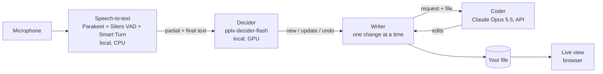

# Voice Coding

Talk while you code: small spoken requests become edits to the file in front of you, while you keep talking.

Typing a prompt and waiting for a full answer breaks your flow. Here you just say what you want while looking at the
code ("rename get user to fetch user", "also handle None", "no, revert that"). Each request becomes an edit a second
or two later, while you're already on to the next one. Corrections are as cheap as saying them.

## How it works



1. **Speech-to-text**: partial text every ~0.2 s while you talk. At a pause, Smart Turn judges from the audio whether
   you're done (the decider's text verdict breaks ties), so a sentence ends ~0.3 s after you stop instead of a fixed
   0.5 s, and a pause mid-sentence doesn't cut it.
2. **Decider**: a small local model reads the speech not acted on yet and picks: ignore (filler, small talk), wait
   (incomplete), new task, update a task, or undo. It also decides on partial text, so work starts before the sentence ends.
3. **Coder**: Claude gets the current file plus one spoken request and returns small search/replace edits through a
   strict tool. The diff is computed locally, so it always applies.
4. **Writer**: applies changes one at a time, in order. Each spoken request is an undoable step: "revert it" restores
   the file exactly from a local snapshot, without an API call.
5. **Live view**: a browser page that shows the file and highlights each change as it lands.

**Design decisions**

- **Act early, correct later.** An edit is written as soon as a request is clear, even mid-sentence; when the full
  sentence arrives, only the difference is applied. This works because every edit can be undone exactly.
- **Local where latency matters, cloud where quality matters.** Speech and decisions run on the machine; only the code
  edit goes to Claude.
- **Small, fast model output.** Claude returns only search/replace snippets (no summaries, no whole files), in fast
  mode, with the file prompt-cached and the cache pre-warmed after every change.
- **Careful undo.** Undo removes only the last spoken request of a task, and only once the sentence is finished
  ("no, remove it from here and…" is an update, not an undo).
- **CPU/GPU split.** Speech-to-text runs on the CPU, so it doesn't compete with the decider on the GPU.

## Tools, models and APIs

| Part | Tool / model | Runs on | Used for |
|---|---|---|---|
| Coder | [Claude API](https://platform.claude.com/docs): Claude Opus 5.5 with fast mode, prompt caching and strict tool use, via the `anthropic` Python SDK | Cloud | Turning a spoken request into code edits |
| Decider | [pplx-decider-flash v1.2](https://huggingface.co/perplexity-ai/pplx-decider-flash-gguf-v1.2) (Perplexity, GGUF Q8) via [llama.cpp](https://github.com/ggml-org/llama.cpp) (`llama-cpp-python`) | Local GPU (Metal) | Ignore / wait / new / update / undo per sentence |
| Speech-to-text | [Parakeet TDT-CTC 110M](https://huggingface.co/mlx-community/parakeet-tdt_ctc-110m) (NVIDIA) via `parakeet-mlx` on Apple MLX | Local CPU | Transcription |
| Voice activity | [Silero VAD](https://github.com/snakers4/silero-vad) (PyTorch) | Local CPU | Finding speech and pauses |
| End of turn | [Smart Turn v3](https://huggingface.co/pipecat-ai/smart-turn-v3) (Pipecat) via ONNX Runtime | Local CPU | Deciding at a pause whether you're done |
| Audio input | `sounddevice` (PortAudio) | Local | Microphone |
| Live view | Python `http.server`, Server-Sent Events, plain HTML/JS | Local | Browser view of the file |
| Tooling | Python 3.14, `asyncio`, [uv](https://docs.astral.sh/uv/), `huggingface_hub`, `python-dotenv` | | Runtime, packages, model downloads, config |

## Setup

Tested on an Apple Silicon Mac (M4, 32 GB). You need [uv](https://docs.astral.sh/uv/) (it installs Python 3.14 if
needed), an [Anthropic API key](https://platform.claude.com), and ~6 GB of disk for the models.

```bash
git clone https://github.com/TimCares/jamie-hackathon-20261024.git
cd jamie-hackathon-20261024/python
cp .env.example .env        # then add your key: ANTHROPIC_API_KEY=...
uv sync --extra gguf        # installs everything, including llama.cpp
```

The first start downloads the models into `python/.hf` and `python/.models` (~5.3 GB: decider 4.8 GB, Parakeet 0.44 GB,
Smart Turn 8 MB). No Hugging Face login is needed. macOS asks for microphone access for your terminal on the first run.

## Usage

```bash
uv run --extra gguf python -m voice sample/user_service.py   # talk to the file
uv run python -m voice.live_view sample/user_service.py      # optional: watch it at http://localhost:8765
```

Any text file works; `sample/user_service.py` is a small example. Things to try: "add a docstring to parse config",
"also mention it raises a ValueError", "rename get user to fetch user", "actually, never mind".

The terminal shows everything as it happens: transcripts (`~` partial, `>` final), each decision with its probabilities,
task events (`=>`) and file changes (`<>`) with their diffs. Stop with Ctrl+C. The file is edited in place, so use a
copy or a file under git.

## Performance

Measured on an M4 MacBook Pro:

| Step | Time |
|---|---|
| Speech-to-text | partial text every ~0.2 s; a sentence ends ~0.3 s after you stop |
| Decider | ~0.4–0.8 s per decision |
| Coder (Claude, fast mode, cached file) | ~1.2–2 s per edit (median ~1.6 s) |
| Undo | instant (local snapshot, no API call) |

A request usually shows up in the file 1–2 s after you've said it, often while you're still talking.

## Project structure

```
python/
  voice/
    __main__.py       wires everything together and prints it (python -m voice FILE)
    transcriber.py    speech-to-text: VAD, Parakeet, Smart Turn
    tasks.py          the decider: ignore / wait / new / update / undo
    coder.py          Claude: request + file -> search/replace edits -> git diff
    coder_system.md   the coder's system prompt
    writer.py         applies edits one at a time; undo per request
    live_view.py      browser live view (+ live_view.html)
  decider.py, decider_gguf.py   the decider model (PyTorch / llama.cpp)
  bench_decider*.py             decider benchmarks
  agent.py                      minimal Claude agent loop
  sample/                       files to talk to
```

## Limitations

- Built and tested on Apple Silicon only. MLX, llama.cpp and ONNX Runtime also run on Linux and Windows, but that's
  untested, and the decider needs a GPU to stay fast.
- English only (the speech model).
- One file per session; no switching files by voice.
- Misheard partial speech can briefly produce a wrong edit; it is corrected when the full sentence arrives.
- Nothing checks that the edited code still compiles or runs.

## License

MIT (see [LICENSE](LICENSE)). Models: pplx-decider (Apache-2.0), Parakeet (CC-BY-4.0), Smart Turn (BSD-2-Clause),
Silero VAD (MIT).
